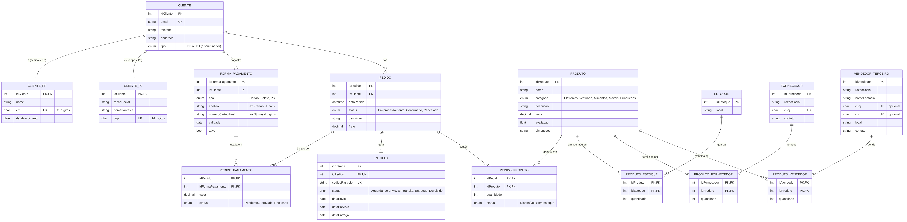

# Projeto Conceitual de Banco de Dados – E-commerce

Desafio de projeto da DIO: refinar o modelo de e-commerce construído em aula, aplicando os pontos pedidos no enunciado.

> O diagrama foi feito em **Mermaid** (arquivo [`ecommerce.mmd`](ecommerce.mmd)) e também aparece renderizado direto aqui no GitHub, logo abaixo.

## Refinamentos aplicados

### 1. Cliente PF ou PJ (nunca os dois)
- A entidade **CLIENTE** guarda os dados comuns (e-mail, telefone, endereço) e o atributo **`tipo`** (`PF` ou `PJ`), que funciona como discriminador.
- Os dados específicos ficam em **CLIENTE_PF** (nome, CPF) e **CLIENTE_PJ** (razão social, CNPJ).
- Nas duas tabelas a chave `idCliente` é **PK e FK** ao mesmo tempo, então cada cliente tem no máximo um registro em cada uma.
- É uma **especialização disjunta e total**: o `tipo` define em qual das duas tabelas o cliente entra, e uma conta não pode ter CPF e CNPJ ao mesmo tempo.

### 2. Várias formas de pagamento
- **FORMA_PAGAMENTO** fica ligada ao cliente (1:N), então ele pode cadastrar cartão, boleto, Pix etc.
- Por segurança, do cartão se guarda só o final (últimos 4 dígitos).
- **PEDIDO_PAGAMENTO** (N:M) permite dividir um pedido entre mais de uma forma de pagamento, com o valor pago em cada uma.

### 3. Entrega com status e código de rastreio
- **ENTREGA** está ligada ao pedido (`idPedido` é FK e UK, ou seja, 1 entrega por pedido).
- Atributos principais: **`status`** (Aguardando envio, Em trânsito, Entregue, Devolvido) e **`codigoRastreio`** (único).

## Entidades e chaves

| Entidade | PK | FK |
| --- | --- | --- |
| CLIENTE | idCliente | – |
| CLIENTE_PF | idCliente | idCliente → CLIENTE |
| CLIENTE_PJ | idCliente | idCliente → CLIENTE |
| FORMA_PAGAMENTO | idFormaPagamento | idCliente → CLIENTE |
| PEDIDO | idPedido | idCliente → CLIENTE |
| PEDIDO_PAGAMENTO | (idPedido, idFormaPagamento) | idPedido → PEDIDO, idFormaPagamento → FORMA_PAGAMENTO |
| ENTREGA | idEntrega | idPedido → PEDIDO |
| PRODUTO | idProduto | – |
| PEDIDO_PRODUTO | (idPedido, idProduto) | idPedido → PEDIDO, idProduto → PRODUTO |
| ESTOQUE | idEstoque | – |
| PRODUTO_ESTOQUE | (idProduto, idEstoque) | idProduto → PRODUTO, idEstoque → ESTOQUE |
| FORNECEDOR | idFornecedor | – |
| PRODUTO_FORNECEDOR | (idFornecedor, idProduto) | idFornecedor → FORNECEDOR, idProduto → PRODUTO |
| VENDEDOR_TERCEIRO | idVendedor | – |
| PRODUTO_VENDEDOR | (idVendedor, idProduto) | idVendedor → VENDEDOR_TERCEIRO, idProduto → PRODUTO |

## Diagrama (Mermaid)

```mermaid
erDiagram
    CLIENTE ||--o| CLIENTE_PF : "é (se tipo = PF)"
    CLIENTE ||--o| CLIENTE_PJ : "é (se tipo = PJ)"
    CLIENTE ||--o{ FORMA_PAGAMENTO : "cadastra"
    CLIENTE ||--o{ PEDIDO : "faz"
    PEDIDO ||--|{ PEDIDO_PAGAMENTO : "é pago por"
    FORMA_PAGAMENTO ||--o{ PEDIDO_PAGAMENTO : "usada em"
    PEDIDO ||--o| ENTREGA : "gera"
    PEDIDO ||--|{ PEDIDO_PRODUTO : "contém"
    PRODUTO ||--o{ PEDIDO_PRODUTO : "aparece em"
    PRODUTO ||--o{ PRODUTO_ESTOQUE : "armazenado em"
    ESTOQUE ||--o{ PRODUTO_ESTOQUE : "guarda"
    FORNECEDOR ||--o{ PRODUTO_FORNECEDOR : "fornece"
    PRODUTO ||--o{ PRODUTO_FORNECEDOR : "fornecido por"
    VENDEDOR_TERCEIRO ||--o{ PRODUTO_VENDEDOR : "vende"
    PRODUTO ||--o{ PRODUTO_VENDEDOR : "vendido por"

    CLIENTE {
        int idCliente PK
        string email UK
        string telefone
        string endereco
        enum tipo "PF ou PJ (discriminador)"
    }
    CLIENTE_PF {
        int idCliente PK, FK
        string nome
        char cpf UK "11 dígitos"
        date dataNascimento
    }
    CLIENTE_PJ {
        int idCliente PK, FK
        string razaoSocial
        string nomeFantasia
        char cnpj UK "14 dígitos"
    }
    FORMA_PAGAMENTO {
        int idFormaPagamento PK
        int idCliente FK
        enum tipo "Cartão, Boleto, Pix"
        string apelido "ex: Cartão Nubank"
        string numeroCartaoFinal "só últimos 4 dígitos"
        date validade
        bool ativo
    }
    PEDIDO {
        int idPedido PK
        int idCliente FK
        datetime dataPedido
        enum status "Em processamento, Confirmado, Cancelado"
        string descricao
        decimal frete
    }
    PEDIDO_PAGAMENTO {
        int idPedido PK, FK
        int idFormaPagamento PK, FK
        decimal valor
        enum status "Pendente, Aprovado, Recusado"
    }
    ENTREGA {
        int idEntrega PK
        int idPedido FK, UK
        string codigoRastreio UK
        enum status "Aguardando envio, Em trânsito, Entregue, Devolvido"
        date dataEnvio
        date dataPrevista
        date dataEntrega
    }
    PRODUTO {
        int idProduto PK
        string nome
        enum categoria "Eletrônico, Vestuário, Alimentos, Móveis, Brinquedos"
        string descricao
        decimal valor
        float avaliacao
        string dimensoes
    }
    PEDIDO_PRODUTO {
        int idPedido PK, FK
        int idProduto PK, FK
        int quantidade
        enum status "Disponível, Sem estoque"
    }
    ESTOQUE {
        int idEstoque PK
        string local
    }
    PRODUTO_ESTOQUE {
        int idProduto PK, FK
        int idEstoque PK, FK
        int quantidade
    }
    FORNECEDOR {
        int idFornecedor PK
        string razaoSocial
        char cnpj UK
        string contato
    }
    PRODUTO_FORNECEDOR {
        int idFornecedor PK, FK
        int idProduto PK, FK
        int quantidade
    }
    VENDEDOR_TERCEIRO {
        int idVendedor PK
        string razaoSocial
        string nomeFantasia
        char cnpj UK "opcional"
        char cpf UK "opcional"
        string local
        string contato
    }
    PRODUTO_VENDEDOR {
        int idVendedor PK, FK
        int idProduto PK, FK
        int quantidade
    }
```

## Ferramentas
- [Mermaid](https://mermaid.js.org/) para o diagrama entidade-relacionamento
- GitHub para versionamento e entrega
